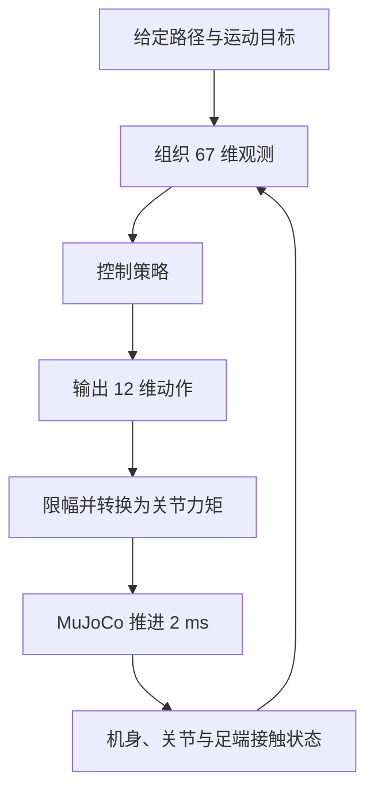

# Mini Lite 四足机器人 MuJoCo 仿真

> **项目主题：基于策略学习的四足机器人直接力矩控制与路径跟踪。**
>
> 在 MuJoCo 中建立 Mini Lite 机器人的物理模型，通过策略协调十二个关节，使机器人沿直线、曲线和转弯路径行走，同时控制机身姿态与运动平稳性。

项目已形成 **模型构建 → 策略训练与优化 → 仿真运行 → 定量验收 → 视频演示** 的完整流程。当前默认策略通过了规定的 **9 项平地路径跟踪测试**。
## 一、项目目标

四足机器人需要不断交替支撑和抬腿，在前进、转向的同时保持身体稳定。本项目将这些要求落实为三个相互关联的目标：

- **沿路径行走**：跟随给定路径，并能从存在横向偏移的起始位置逐步回到路径附近。
- **保持机身平稳**：约束左右倾斜、前后俯仰和上下起伏，减小行走中的机身摆动。
- **维持正常步态**：在满足力矩与关节速度限制的同时，保持足端抬起、落地和支撑的协调。

MuJoCo 负责计算机器人在重力、关节力矩和地面接触作用下的运动；控制策略根据反馈状态持续调整十二个关节的输出。运动效果通过轨迹、姿态、足端接触和视频共同观察。

## 二、机器人模型与仿真平台

模型采用提供的 [Mini Lite 模型资源](E:/机器狗文件/model)，动力学参数与关节限值以 URDF 为主要依据。URDF 描述身体和关节的结构关系、质量及惯量；STL 网格呈现机器人外形；转换后的 MuJoCo XML 定义实际仿真对象。参数处理与转换依据记录在 [模型来源与参数](D:/Download/桌面/rl/docs/模型来源与参数.md) 中。

| 项目        | 当前配置                                       |
| --------- | ------------------------------------------ |
| 机器人结构     | 四条腿，每条腿包含髋外展、髋屈伸、膝关节，共 12 个受控关节            |
| 模型总质量     | 约 10.009 kg                                |
| 物理步长与控制周期 | 2 ms，每个物理步计算一次策略动作，即 500 Hz                |
| 策略输入与输出   | 67 维观测 → 12 维关节动作                          |
| 目标运动状态    | 机身高度 0.31 m，前进速度 0.13 m/s                  |
| 步态相位周期    | 0.70 s，为策略提供周期性输入特征                        |
| 各腿关节力矩上限  | 当前动作缩放后为 5.28 / 5.28 / 11.2 N·m，依次对应上述三个关节 |

目标高度和速度是控制配置，实际运动状态随仿真过程变化。回放与录像默认采用 60 FPS，控制计算仍按 500 Hz 执行。

## 三、控制原理

控制的核心是一个不断重复的闭环：**读取机器人状态，计算关节力矩，推进物理仿真，再读取运动后的状态。**



**观测提供运动依据。** 输入包含机身姿态相关量、线速度和角速度、关节位置与速度、上一时刻动作、四足接触情况，以及前方路径参考点、路径误差和步态相位等信息。策略据此判断机器人当前如何运动、距离目标路径有多远，以及如何调整下一步动作。

**策略直接输出关节力矩动作。** 十二维动作分别对应十二个关节。动作先限制在 $[-1,1]$，再按各关节限值缩放：

$$
\tau_i=\operatorname{clip}(a_i,-1,1)\times 0.4\times\tau_{i,\mathrm{limit}}
$$

其中，$a_i$ 为第 $i$ 个关节的策略动作，$\tau_{i,\mathrm{limit}}$ 为模型关节力矩限值。每条腿三个关节的模型限值为 13.2 / 13.2 / 28 N·m，乘以 0.4 后得到当前实际输出上限。

**路径误差参与腿部运动调整。** 策略包含可学习的状态反馈、步态相位特征，以及路径误差与相位的交互特征，使姿态维持和路径修正能够共同影响关节输出。路径由程序预先定义，路径相关观测由仿真状态与路径几何计算得到。

## 四、强化学习任务设计

本项目把运动控制组织成“**观测 → 策略动作 → 物理运动 → 奖励与结束信号**”的交互过程。MuJoCo 计算运动，Gymnasium 环境提供统一接口，神经策略根据观测输出十二个关节动作。训练程序根据多次交互的结果调整策略参数。

以下说明以当前默认策略保存的配置为准：`stage='path'`、`reward_version=5`、`reference_reward=False`。控制周期为 2 ms，目标速度为 0.13 m/s，目标机身高度为 0.31 m。具体实现见 [env.py](D:/Download/桌面/rl/purequad/env.py:69)。

### 4.1 观测、动作和学习目标

| 强化学习要素   | 本项目中的对应对象                    |
| -------- | ---------------------------- |
| 环境       | 机器人模型、地面接触、路径、奖励与结束规则        |
| 策略       | 根据 67 维观测计算动作的神经网络           |
| 观测 $o_t$ | 当前机身、关节、接触、路径误差及步态相位信息       |
| 动作 $a_t$ | 12 维归一化关节动作，经过限幅、缩放后成为力矩     |
| 奖励 $r_t$ | 本控制步的运动表现评分                  |
| 一回合      | 从 `reset()` 开始，到成功、失败或达到时限结束 |

策略学习的目标是提高一段运动的累计回报。PPO 使用带折扣的目标，可写为：

$$
J(\theta)=\mathbb E\!\left[\sum_{t=0}^{T-1}\gamma^t r_t\right]
$$

$\theta$ 表示网络参数，$\gamma$ 表示未来奖励的折扣因子。项目 [PPO 训练入口](D:/Download/桌面/rl/purequad/train.py:81) 设置 $\gamma=0.9995$。CEM 则根据候选策略的仿真回报与约束评分搜索参数，具体流程见下一节。

普通回放时，策略权重保持固定。环境仍会计算奖励和记录运动数据，权重更新发生在训练或参数搜索过程中。

### 4.2 67 维观测分别是什么

下面的索引与源码一致，**从 0 开始编号，因此最后一项是 66**。$R$ 为机身坐标到世界坐标的旋转矩阵，$R^\mathsf T$ 将世界向量转换到机身坐标。

| 观测索引  |  维数 | 对应内容与顺序                   | 实际计算或缩放                                          |
| ----- | --: | ------------------------- | ------------------------------------------------ |
| 0～2   |   3 | 机身坐标中的重力方向，依次为 x、y、z 分量   | $R^\mathsf T[0,0,-1]^\mathsf T$；为无量纲方向           |
| 3～5   |   3 | 机身坐标中的线速度，依次为 x、y、z 分量    | $R^\mathsf T\,\mathrm{qvel}[0:3]$，m/s            |
| 6～8   |   3 | 浮动基座的三个角速度分量              | 直接取 `qvel[3:6]`，rad/s                            |
| 9～20  |  12 | 十二个关节相对于中立姿态的角度偏差         | $q-q_0$，rad；关节顺序见下表                              |
| 21～32 |  12 | 十二个关节角速度                  | $\dot q/10$                                      |
| 33～44 |  12 | 上一次执行的缩放动作                | $u_{t-1}=0.4\,\operatorname{clip}(a_{t-1},-1,1)$ |
| 45～48 |   4 | 四脚接触标志，依次为 FL、FR、RL、RR    | 有接触为 1，无接触为 0                                    |
| 49～50 |   2 | 沿路径前方 0.2 m 参考点的相对 x、y 坐标 | 相对机器人位置，按机身偏航旋转到局部平面坐标，m                         |
| 51～52 |   2 | 沿路径前方 0.6 m 参考点的相对 x、y 坐标 | 同上                                               |
| 53～54 |   2 | 沿路径前方 1.0 m 参考点的相对 x、y 坐标 | 同上                                               |
| 55    |   1 | 带符号的横向路径误差 $e_y$          | 单位 m                                             |
| 56    |   1 | 航向误差的正弦                   | $\sin(e_\psi)$                                   |
| 57    |   1 | 航向误差的余弦                   | $\cos(e_\psi)$                                   |
| 58    |   1 | 机身高度相对于目标的偏差              | $10(h-0.31)$                                     |
| 59    |   1 | 目标前进速度                    | 当前路径任务为 0.13 m/s；站立任务为 0                         |
| 60    |   1 | 基频时钟的正弦                   | $g(t)\sin\varphi$                                |
| 61    |   1 | 基频时钟的余弦                   | $g(t)\cos\varphi$                                |
| 62    |   1 | 二次谐波的正弦                   | $g(t)\sin(2\varphi)$                             |
| 63    |   1 | 二次谐波的余弦                   | $g(t)\cos(2\varphi)$                             |
| 64    |   1 | 三次谐波的正弦                   | $g(t)\sin(3\varphi)$                             |
| 65    |   1 | 三次谐波的余弦                   | $g(t)\cos(3\varphi)$                             |
| 66    |   1 | 常数特征                      | 1                                                |
关节角度、关节速度、上一动作和十二个输出动作共用同一套关节顺序。FL/FR 为左前/右前，RL/RR 为左后/右后：

| 关节     | 角度偏差索引 | 速度索引 | 上一缩放动作索引 | 输出动作索引 |     |
| ------ | -----: | ---: | -------: | -----: | --- |
| FL 髋外展 |      9 |   21 |       33 |      0 |     |
| FL 髋屈伸 |     10 |   22 |       34 |      1 |     |
| FL 膝关节 |     11 |   23 |       35 |      2 |     |
| FR 髋外展 |     12 |   24 |       36 |      3 |     |
| FR 髋屈伸 |     13 |   25 |       37 |      4 |     |
| FR 膝关节 |     14 |   26 |       38 |      5 |     |
| RL 髋外展 |     15 |   27 |       39 |      6 |     |
| RL 髋屈伸 |     16 |   28 |       40 |      7 |     |
| RL 膝关节 |     17 |   29 |       41 |      8 |     |
| RR 髋外展 |     18 |   30 |       42 |      9 |     |
| RR 髋屈伸 |     19 |   31 |       43 |     10 |     |
| RR 膝关节 |     20 |   32 |       44 |     11 |     |

这些输入有三个需要明确的细节：

- 机身倾斜主要通过重力方向反映；角速度索引 6～8 直接读取仿真 `qvel`，没有在该表达式中再次旋转，也没有由欧拉角差分得到。
- 上一动作索引 33～44 已乘 `action_scale=0.4`，正常范围为 $[-0.4,0.4]$，尚未乘各关节的力矩限值。
- 全部观测在返回前进行非有限值处理、裁剪到 $[-10,10]$ 并转为 `float32`。各组缩放不等同于对所有输入做统一的均值方差标准化。

当前路径型策略还在网络内部构造十二个“路径误差 × 时钟”交互特征。它们由现有观测第 55、56 项与第 60～65 项相乘得到，环境输入仍为 67 维；结合 64 维隐藏特征后，动作输出层接收 $64+67+12=143$ 维特征。详见 [[机器狗学习/相关项目/Mujoco仿真/assets/policy.py|policy.py 笔记]]。

### 4.3 奖励函数如何评价运动

环境在每一步将各项奖励相加：

$$
r_t=\sum_k r_t^{(k)}
$$

下面列出**当前路径任务、第 5 版奖励实际生效的全部 20 项**。它们共同鼓励沿路径前进、机身平稳和动作适度；各系数在代码中设定。公式按奖励字典最终生效的值整理。

先约定表中符号：

- $\Delta t=0.002$ s；$h$ 为机身高度；$\rho,\vartheta$ 为横滚与俯仰角；$s$ 为沿路径进度，$\Delta s=s_t-s_{t-1}$。
- $v_x,v_y,v_z$ 为动作执行后的机身坐标线速度；$\omega_1,\omega_2$ 直接对应 `qvel[3:5]` 两个分量。
- $u_t=0.4\,\operatorname{clip}(a_t,-1,1)$ 为缩放动作；$\dot u_t=(u_t-u_{t-1})/\Delta t$；$q,\dot q$ 为十二个关节的角度和速度，$\ddot q$ 由相邻控制步角速度差分得到。
- $n_{\mathrm{bad}}$ 为当前步的非足部触地条目数；$P=\sum_i|\tau_i\dot q_i^{\mathrm{pre}}|$ 为各关节机械功率绝对值之和，速度取物理步进前的值。它是能耗惩罚的近似依据。

速度奖励使用一阶平均速度和目标速度：

$$
\bar{\mathbf v}_t=\bar{\mathbf v}_{t-1}
+\alpha(\mathbf v_t-\bar{\mathbf v}_{t-1}),
\qquad
\alpha=\min(1,\Delta t/0.15)
$$

$$
v^\star(t)=
\begin{cases}
0,&t<0.6\ \mathrm{s}\\
0.13,&t\ge0.6\ \mathrm{s}
\end{cases},
\qquad
E_v=(\bar v_x-v^\star)^2+\bar v_y^2
$$

直立与高度奖励还乘以前进相关系数：

$$
m_t=0.1+0.9\,\operatorname{clip}(v_x/0.13,0,1)
$$

下面用 $\operatorname{mean}$ 表示对十二个关节求平均：

| 奖励键                  | 当前表达式                                                   | 目的             |
| -------------------- | ------------------------------------------------------- | -------------- |
| `alive`              | $\Delta t$                                              | 鼓励持续运行         |
| `upright`            | $8\exp[-(\rho^2+\vartheta^2)/0.002]\,m_t\Delta t$       | 鼓励机身保持水平       |
| `height`             | $6\exp[-((h-0.31)/0.006)^2]\,m_t\Delta t$               | 鼓励接近目标高度       |
| `velocity`           | $10\exp[-E_v/0.04^2]\,\Delta t$                         | 鼓励速度接近目标、侧向速度小 |
| `speed_error`        | $-150E_v\Delta t$                                       | 进一步处罚速度误差      |
| `progress`           | $2\Delta s$                                             | 奖励沿路径取得进展      |
| `cross_track`        | $-120e_y^2\Delta t$                                     | 惩罚横向偏离路径       |
| `heading`            | $-8e_\psi^2\Delta t$                                    | 惩罚与路径切线的航向差    |
| `vertical_quiet`     | $2\exp[-(v_z/0.015)^2]\,\Delta t$                       | 奖励较小的竖直速度      |
| `vertical_velocity`  | $-40v_z^2\Delta t$                                      | 惩罚机身上下运动       |
| `body_rotation_rate` | $-2(\omega_1^2+\omega_2^2)\Delta t$                     | 惩罚机身转动过快       |
| `pose`               | $2\exp[-\operatorname{mean}((q-q_0)^2)/0.02]\,\Delta t$ | 鼓励关节姿态适度接近中立姿态 |
| `body_contact`       | $-40n_{\mathrm{bad}}\Delta t$                           | 惩罚非足部触地        |
| `joint_velocity`     | $-0.0002\sum_i\dot q_i^2\Delta t$                       | 惩罚过快的关节运动      |
| `energy`             | $-0.00005P\Delta t$                                     | 惩罚较大的机械功率      |
| `torque`             | $-0.02\operatorname{mean}(u_t^2)\Delta t$               | 惩罚较大的缩放动作幅值    |
| `smooth`             | $-0.02\operatorname{mean}((u_t-u_{t-1})^2)$             | 惩罚相邻动作突变       |
| `joint_acceleration` | $-10^{-6}\operatorname{mean}(\ddot q^2)\Delta t$        | 惩罚关节角加速度过大     |
| `torque_rate`        | $-10^{-4}\operatorname{mean}(\dot u_t^2)\Delta t$       | 惩罚缩放动作的变化率过大   |
| `terminal`           | 失败为 −50；否则成功为 +100；其余为 0                                | 给出一次性的回合结束反馈   |

torque` 与 `torque_rate` 的名字需要结合公式理解：它们分别使用缩放动作 $u$ 及其变化率；[评估模块](D:/Download/桌面/rl/purequad/evaluate.py:71) 记录的力矩变化率则基于实际 N·m 力矩。

`pose` 直接比较中立关节姿态。CEM 搜索、平稳性优化和 PPO 训练中的候选选择，还会在环境回报之外计算抬脚、腾空比例、前进量等约束扣分。因此应分别查看**环境单步奖励、候选选择分数和最终验收条件**。源码详解见 [[机器狗学习/相关项目/Mujoco仿真/assets/env.py|env.py 笔记]]、[[机器狗学习/相关项目/Mujoco仿真/assets/cem.py|cem.py 笔记]] 与 [[机器狗学习/相关项目/Mujoco仿真/assets/smooth_train.py|smooth_train.py 笔记]]。

#### 五个奖励版本分别做什么

当前环境实现了 **`reward_version=1～5` 五种奖励配置**。它们在同一个 `step()` 中，按基础项和后续条件分支组织。奖励版本用于选择评分项与系数；训练流程编号 `phase` 用于选择训练步骤，二者需要分别对应。当前默认策略保存的是 `stage='path'`、`reward_version=5`、`reference_reward=False`，上面的 20 项表列出其最终生效结果。

| 奖励版本 | 主要用途 | 本版本的主要设置或调整 |
| --- | --- | --- |
| 1 | 提供基础站立与运动目标 | 直立、目标高度、目标速度、中立关节姿态，以及接触、能耗、动作幅值和突变等评分；按任务启用前进与路径误差项 |
| 2 | 加强速度跟踪与路径纠偏 | 改用平均速度评分，增加显式速度误差惩罚、竖直速度惩罚；降低前进增量奖励，运动任务也计入横向误差 |
| 3 | 更严格地保持机身姿态和高度 | 收紧直立与高度奖励的误差范围，增加竖直速度接近零的正奖励 |
| 4 | 加强关节与机身运动的平滑性 | 增加关节加速度、缩放动作变化率、机身转动速度惩罚，并加强高度保持与竖直速度约束 |
| 5 | 针对当前 URDF 调整平滑惩罚强度 | 保留第 4 版的评分结构，降低关节加速度和缩放动作变化率两项系数，调整平稳性与正常行走之间的权衡 |

下面逐项说明。符号沿用本节前面的定义，$u$ 为缩放动作，$\Delta t=0.002$ s，$m_t$ 为前进相关系数。

**版本 1：基础奖励，先明确怎样的运动值得鼓励。**

基础项鼓励机身水平、高度接近 0.31 m、速度接近目标、关节适度接近中立姿态，并抑制非足部接触、关节高速运动、机械功率、动作幅值及动作突变。它同时包含运动任务的基础评分：非站立任务使用航向误差惩罚和 $20\Delta s$ 的前进奖励；此时横向误差惩罚只在 `stage='path'` 启用。站立任务的航向、横向与前进项为 0。

版本 1 的速度奖励使用当前步速度：

$$
r_{\mathrm{velocity}}=c_v\exp\!\left[-\frac{(v_x-v^\star)^2+v_y^2}{0.04^2}\right]\Delta t,
\qquad
c_v=\begin{cases}2,&\texttt{stage=stand}\\10,&\text{其他任务}\end{cases}
$$

站立时目标速度始终为 0；运动和路径任务在前 0.6 s 的奖励目标速度为 0，之后为 0.13 m/s。默认七阶段流程首先使用版本 1 训练站立。代码见 [env.py 基础奖励](D:/Download/桌面/rl/purequad/env.py:128)。

**版本 2：更关注持续的速度跟踪和纠偏。**

速度评分改用一阶平均速度，误差定义为：

$$
E_v=(\bar v_x-v^\star)^2+\bar v_y^2
$$

速度正奖励使用 $10\exp[-E_v/0.04^2]\Delta t$，并额外加入：

$$
r_{\mathrm{speed\ error}}=-150E_v\Delta t
$$

同时，将前进奖励从 $20\Delta s$ 降至 $2\Delta s$，降低单纯追求前进距离的激励；`motion` 和 `path` 都启用 $-120e_y^2\Delta t$ 的横向误差惩罚，并加入 $-10v_z^2\Delta t$ 的竖直速度惩罚。平均速度的计算公式见本节前文。代码见 [env.py 版本 2 分支](D:/Download/桌面/rl/purequad/env.py:141)。

**版本 3：进一步减少身体倾斜和上下起伏。**

在版本 2 的基础上，提高直立奖励的峰值，并收紧姿态、高度误差对应的指数宽度：

| 奖励项 | 基础设置 | 版本 3 设置 |
| --- | --- | --- |
| 直立 | $6\exp[-(\rho^2+\vartheta^2)/0.02]\,m_t\Delta t$ | $8\exp[-(\rho^2+\vartheta^2)/0.002]\,m_t\Delta t$ |
| 高度 | $4\exp[-((h-0.31)/0.02)^2]\,m_t\Delta t$ | $5\exp[-((h-0.31)/0.008)^2]\,m_t\Delta t$ |

此外，加入竖直速度接近零的正奖励：

$$
r_{\mathrm{vertical\ quiet}}=2\exp[-(v_z/0.015)^2]\Delta t
$$

高度奖励的误差宽度从 20 mm 缩小到 8 mm，表示偏离目标后奖励衰减得更快；指数宽度本身不构成终止阈值。默认流程第 2～6 阶段使用版本 3，其中第 4 阶段从前一阶段继承该配置。代码见 [env.py 版本 3 分支](D:/Download/桌面/rl/purequad/env.py:148)。

**版本 4：对关节和机身运动增加平滑性约束。**

在版本 3 的基础上新增：

$$
r_{\mathrm{joint\ acceleration}}=-0.0025\,\operatorname{mean}(\ddot q^2)\Delta t
$$

$$
r_{\mathrm{torque\ rate}}=-0.1\,\operatorname{mean}(\dot u^2)\Delta t,
\qquad \dot u=\frac{u_t-u_{t-1}}{\Delta t}
$$

$$
r_{\mathrm{body\ rotation\ rate}}=-2(\omega_1^2+\omega_2^2)\Delta t
$$

三项分别抑制关节速度的剧烈变化、相邻动作的剧烈变化，以及机身横滚和俯仰方向的快速转动。`torque_rate` 奖励使用缩放动作的变化率；它尚未乘各关节 N·m 力矩限值。

此版本还将高度奖励改为 $6\exp[-((h-0.31)/0.006)^2]\,m_t\Delta t$，将竖直速度惩罚改为 $-40v_z^2\Delta t$。代码见 [env.py 版本 4 分支](D:/Download/桌面/rl/purequad/env.py:154)。

**版本 5：保留平滑要求，重新调整两项惩罚系数。**

源码注明这一调整针对当前提供的 URDF。相对于版本 4，最终覆盖的两项为：

| 惩罚项 | 版本 4 的系数 | 版本 5 最终系数 | 降低比例 |
| --- | ---: | ---: | ---: |
| $\operatorname{mean}(\ddot q^2)\Delta t$ | 0.0025 | $10^{-6}$ | 2500 倍 |
| $\operatorname{mean}(\dot u^2)\Delta t$ | 0.1 | $10^{-4}$ | 1000 倍 |

控制周期仅为 2 ms，差分求导后再平方会放大这些量；惩罚过强可能压制正常抬腿和动作调整。这解释了为何需要对系数进行权衡。版本 5 保留版本 4 的机身转动速度惩罚、高度奖励和竖直速度惩罚，两项差分惩罚改用上表的最终系数。代码见 [env.py 版本 5 分支](D:/Download/桌面/rl/purequad/env.py:161)。

这些系数是代码设置的奖励参数，训练过程中不会因选择版本 5 而自动学习新的奖励权重。

#### 版本 2、4 在哪里生效

各分支使用独立的 `if reward_version >= ...` 判断，符合条件时会依次执行。对于非站立任务：

| 配置的 `reward_version` | 执行顺序 |
| --- | --- |
| 1 | 基础奖励 |
| 2 | 基础 → 版本 2 |
| 3 | 基础 → 版本 2 → 版本 3 |
| 4 | 基础 → 版本 2 → 版本 3 → 版本 4 |
| 5 | 基础 → 版本 2 → 版本 3 → 版本 4 → 版本 5 |

**同一奖励键后续被重新赋值时，使用最后一次赋值的结果。** 例如，版本 5 中的 `joint_acceleration` 最终系数为 $-10^{-6}$，版本 4 的 $-0.0025$ 不再参与该项求和；版本 2 设置的竖直速度系数也会在版本 4 中被覆盖为 $-40$。因此，上面的执行关系包含“新增”和“覆盖”，不能将每个版本的同名奖励重复累加。

代码里的版本 2～5 分支还同时要求 `stage!='stand'`；站立任务会跳过这些分支，即使给它设置较高的奖励版本编号，也不会启用这些运动奖励调整。

具体入口与阶段的关系如下：

- **默认七阶段流程**：第 1 阶段选择版本 1；第 2～6 阶段按流程使用版本 3，内部包含版本 2 的逻辑；第 7 阶段选择版本 5，内部包含版本 4 的逻辑并覆盖两项系数。未单独选择编号 2 或 4，不代表其奖励分支没有使用。
- **PPO 训练入口 `purequad.train`**：执行 `reward_version=max(2, reward_version)`。无来源策略时从默认 1 提升到 2；来源为版本 1 时也提升到 2；来源为 3、4、5 时保留对应配置。这条入口规则不能直接当作某次历史训练已使用版本 2 的记录。
- **平稳性优化入口 `purequad.smooth_train`**：允许通过 `--reward-version` 显式选择 3、4、5，默认选择 5，因此也可以单独比较版本 4 的配置。

奖励版本控制每一步的评分。回合终止判断、CEM 回合后的约束扣分和最终验收指标分别由对应代码计算，见 4.4、5.1 和第六节。代码依据：[PPO 配置](D:/Download/桌面/rl/purequad/train.py:76) · [平稳性优化配置](D:/Download/桌面/rl/purequad/smooth_train.py:85) · [七阶段配方](D:/Download/桌面/rl/new_train.py:12)。

### 4.4 成功、失败与超时条件

`env.step()` 返回 `(obs, reward, terminated, truncated, info)`。其中，`terminated` 表示任务因成功或失败结束；`truncated` 表示尚未成功或失败，但已经达到本次配置的时限。

**成功条件**在路径任务中要求以下两项同时成立：

$$
s_t\ge L-0.1,\qquad
\|\mathbf p_{xy,t}-\mathbf p_{\mathrm{end}}\|<0.2\ \mathrm{m}
$$

$L$ 为参考路径总长度。也就是路径进度进入终点前 0.1 m 范围，同时机身平面位置到终点的距离小于 0.2 m，并且当步没有触发失败。

**失败条件**只要任意一项成立，就结束回合：

| 结束原因 | 当前条件 | 对应含义 |
| --- | --- | --- |
| `nonfinite` | `qpos` 或 `qvel` 出现 NaN / 无穷大 | 物理状态数值异常 |
| `fallen` | $h<0.235$ m，或 $h>0.60$ m，或横滚/俯仰绝对值任一 $>0.7$ rad，约 40.1° | 机身高度或倾斜超出运行范围 |
| `joint_limit` | 全部关节中的最小限位余量 $<0.12$ rad，约 6.88° | 关节过于接近角度上下限 |
| `joint_speed_limit` | 任一关节角速度绝对值 $>20$ rad/s | 关节超速 |
| `off_path` | 横向误差绝对值 $>1.0$ m | 严重偏离路径 |

关节限位余量计算为：

$$
m_q=\min_i\left[\min(q_i-q_{i,\min},\,q_{i,\max}-q_i)\right]
$$

因此，关节还没有越过上下限，也可能因为余量不足而结束。失败和到达终点发生在同一步时，失败优先，结束原因不会记为成功。

**超时条件**为：

$$
N_{\mathrm{step}}\Delta t\ge \texttt{cfg.seconds}
$$

且该步尚未成功或失败，此时 `truncated=True`、`reason='timeout'`。当前策略保存的回合时长为 60 s；回放和验收入口还可以覆盖时长，例如验收默认最多运行 75 s，但要求 60 s 内完成。单纯超时的 `terminal` 奖励为 0，整步仍可能包含其他奖励。

运行结束条件用于判断何时停止一回合；九场景验收则在回放后判断整段运动是否达到要求。两类标准应分别阅读：

| 指标 | 环境立即失败条件 | 九场景验收要求 |
| --- | --- | --- |
| 横滚／俯仰 | 任一分量绝对值 $>0.7$ rad | 全程最大分量绝对值 $\le0.08$ rad，约 4.58° |
| 机身高度 | $h<0.235$ m 或 $h>0.60$ m | 全程最低高度 $\ge0.28$ m |
| 横向误差 | $\lvert e_y\rvert>1.0$ m | 全程最大绝对值 $\le0.15$ m，RMSE $\le0.05$ m |
| 高度峰峰值 | 没有对应的直接终止判断 | 第 1 秒后峰峰值 $\le0.008$ m |
| 非足部触地 | 每步奖励扣分；本身不单独触发终止 | 非足部触地比例必须为 0 |
| 每脚抬脚与腾空比例 | 抬脚不足本身不直接终止 | 第 1 秒后每脚峰值高度至少 29 mm，腾空比例在 0.08～0.55 |

验收还要求在 60 s 内到达终点，关节速度不超过 20 rad/s。因此，机器人没有摔倒、正常到达终点，也可能因摆动、误差或抬脚不足而验收不通过。完整判定见 [validate.py](D:/Download/桌面/rl/purequad/validate.py:31)；各训练阶段如何使用这些奖励和结束信号，见 5.1 节。

## 五、策略训练与优化

项目通过仿真反馈评价策略：机器人沿路径前进、保持目标速度和机身姿态时获得相应回报；偏离路径、动作变化过大或能耗增加等情况会影响评分。训练代码提供分阶段的策略搜索和 PPO 训练接口，并支持针对平稳性的策略权重优化。

| 方法 | 在项目中的作用 |
| --- | --- |
| CEM：交叉熵方法 | 采样多组策略参数，运行仿真并筛选表现较好的候选，逐步更新采样分布；训练阶段覆盖站立、行走、状态反馈、平衡和转向 |
| PPO：近端策略优化 | 提供基于 Stable-Baselines3 的 Actor-Critic 训练与继续训练接口，通过环境交互和奖励更新策略 |
| 局部权重搜索 | 调整策略输出层中与相位、状态反馈等有关的权重，以实际仿真表现筛选机身更平稳的候选 |
| 固定策略验收 | 固定策略文件并运行完整测试组合，检查路径完成、姿态、抬脚和接触等要求 |

平稳性优化同时保留行走约束：机身摆动减小时，仍需检查每条腿的抬脚高度、腾空比例、关节速度和非足部触地情况。最终结果由独立的验收指标判定。

### 5.1 从站立到路径跟踪的分阶段训练

项目将完整行走任务拆成由简到繁的训练内容：**先维持站立，再形成周期行走，然后加入状态反馈、机身平衡和路径转向，最后优化平稳性。** 训练阶段逐步增加要求，帮助策略在已有能力上继续学习。训练与优化结束后，运行时加载一份固定的策略文件执行控制。

这里有四种不同的编号或名称，需要对应理解：

| 名称 | 在代码中控制什么 | 例子 |
| --- | --- | --- |
| `stage`：环境任务 | 目标速度、奖励分支以及是否判定到达路径终点 | `stand`、`motion`、`path` |
| `mode`：CEM 搜索方式 | 本轮允许调整哪一组策略权重 | `stand`、`motion`、`feedback`、`balance`、`steer` |
| `phase`：训练流程编号 | 选择训练程序、前一阶段策略、搜索规模或 PPO 步数等配方 | `new_train.py --phase 1` 至 `--phase 7` |
| `reward_version`：奖励配置编号 | 选择奖励分支及系数；同一任务可使用不同奖励配置 | 默认流程使用 1、3、5；实际运行以保存的 `config.json` 为准 |

#### 三种环境任务分别训练什么

三种任务都使用 **67 维观测和 12 维力矩动作**，主要区别在于运动目标与评分方式。

| 环境任务 | 目标与奖励重点 | 正常回合结束方式 |
| --- | --- | --- |
| `stand`：站立 | 目标前进速度为 0；保持目标高度、身体水平与低平移速度，同时约束动作、能耗和不良接触 | 保持到本回合时限，记为 `timeout`；仍需检查高度、姿态、接触等指标 |
| `motion`：基础运动 | 启动后目标前进速度为 0.13 m/s；协调周期性关节输出，使机器人在保持平衡的同时前进、抬脚和交替支撑 | 通常运行到时限，记为 `timeout`；评价前进量、速度、抬脚与平稳性 |
| `path`：路径跟踪 | 在行走基础上，利用前视路径点、横向误差和航向误差调整方向，完成给定路径 | 达到第四节的路径终点条件时记为 `success`，随后还要检查完整验收指标 |

`success` 的终点判定只在 `stage='path'` 下启用，所以站立或基础运动正常运行至时限时，不能仅凭 `timeout` 判断好坏。是否站稳、是否形成有效行走，需要结合回合内的实际运动指标。

第四节的 20 项奖励表专门描述当前路径配置。站立时，速度目标为 0，速度正奖励系数为 2，航向、横向路径和前进增量奖励为 0；针对非站立任务的后续奖励分支不会应用到站立。`motion` 在使用 `reward_version>=2` 时也会计入横向路径误差，具体以该回合保存的配置为准。

#### 七阶段默认训练配方

[new_train.py](D:/Download/桌面/rl/new_train.py:12) 定义了下面的七阶段流程。**表中规模是当前源码中的默认配方**；CEM 的“代数 × 候选数”表示参数搜索预算，秒数表示每个评估场景的回合上限。

| `phase` | 训练内容 | 算法与环境任务 | 奖励配置 `reward_version` | 默认规模 |
| --- | --- | --- | --- | --- |
| 1 | 站立支撑：搜索偏置及关节角度、关节速度、高度反馈，使机器人在重力下维持站姿 | CEM `mode='stand'`；环境 `stand` | 1 | 40 代 × 96 候选；每场景 4 s |
| 2 | 周期行走：在站立策略上加入周期特征权重，形成四腿协调的前进动作 | CEM `mode='motion'`；环境 `motion` | 3 | 50 代 × 64 候选；每场景 6 s |
| 3 | 行走状态反馈：继续调整关节角度、速度反馈和输出偏置，改善运动时的响应 | CEM `mode='feedback'`；环境 `motion` | 3 | 35 代 × 64 候选；每场景 8 s |
| 4 | PPO 运动优化：以已有运动策略为起点，通过采样、优势估计和梯度更新优化网络 | PPO；环境 `motion` | 继承来源配置；默认流程为 3 | 目标 300,000 环境步，4 个环境；训练回合上限 12 s、短评估 15 s |
| 5 | 机身平衡：优化重力方向、角速度、高度误差和竖直速度到动作的反馈权重 | CEM `mode='balance'`；环境 `motion` | 3 | 28 代 × 64 候选；每场景 8 s |
| 6 | 转向和路径修正：加入横向误差、航向误差、偏航角速度及“路径误差 × 时钟”特征的作用 | CEM `mode='steer'`；环境 `path` | 3 | 32 代 × 64 候选；每场景 7 s，覆盖四组路径起点条件 |
| 7 | 路径运动平稳性：微调关节反馈、周期特征与机身状态反馈，并保持抬脚和前进约束 | `smooth_train.py` 局部 CEM；环境 `path` | 5 | 13 代 × 32 候选；每场景 6 s |

默认流程从第二阶段起读取前一阶段的 `best_policy.zip` 继续训练。`feedback` 和 `balance` 是搜索内容的名称，在环境中仍使用 `motion` 任务。第六阶段则将环境切换为 `path`，并启用路径误差与时钟的交互特征。

#### 各阶段怎样选择奖励函数

**各阶段通过同一个环境选择奖励分支，多个阶段共享一套奖励。** `stage` 决定站立、运动或路径任务，`reward_version` 决定该任务采用哪些奖励项及系数；`mode` 决定 CEM 搜索哪些策略参数。因此，第 2、3、5 阶段分别搜索周期、关节反馈和机身平衡参数，但都使用 `motion` 任务的第 3 版奖励。

五个版本的逐项说明和版本 2、4 的实际执行关系见 4.3 节“**五个奖励版本分别做什么**”及“**版本 2、4 在哪里生效**”。版本 3 包含版本 2 的分支，版本 5 包含版本 4 的分支并覆盖其中两项系数。

| 环境与奖励配置                | 生效目标与评分重点                                                                          |
| ---------------------- | ---------------------------------------------------------------------------------- |
| 第 1 阶段：`stand`、版本 1    | 目标速度为 0；奖励身体水平、高度接近 0.31 m、低水平速度及接近中立关节姿态，同时惩罚不良接触、关节高速运动、能耗和动作突变；航向、横向误差及前进增量项为 0 |
| 第 2～5 阶段：`motion`、版本 3 | 启动后目标速度为 0.13 m/s；奖励前进并抑制侧向速度，强化直立和高度保持，加入竖直速度约束；这一配置也计入横向误差和航向误差                  |
| 第 6 阶段：`path`、版本 3     | 使用上述运动奖励，并启用到达路径终点的成功判定；CEM 还对整个场景的横向和航向 RMSE 计算附加扣分                               |
| 第 7 阶段：`path`、版本 5     | 保留路径运动目标，进一步计入关节加速度、缩放动作变化率和机身转动速度的惩罚，并收紧高度奖励的指数宽度；全部单步奖励见 4.3 节                   |

第 4 阶段 PPO 从来源策略继承奖励配置，并执行 `reward_version=max(2, reward_version)`。按默认七阶段流程，来源为第 3 阶段，故仍使用版本 3；若自行指定其他来源策略，应查看本次输出的 `config.json`。换用 PPO 训练算法本身，不会自动生成一套新的奖励函数。

用三项代表性奖励比较站立与版本 3 运动任务，差别更直观。符号沿用 4.3 节，$\rho,\vartheta$ 为横滚与俯仰，$h$ 为机身高度，$m_t$ 为该节定义的速度相关系数：

| 奖励项 | 站立任务                                          | 运动／路径任务，版本 3                                                          |
| --- | --------------------------------------------- | --------------------------------------------------------------------- |
| 直立  | $6\exp[-(\rho^2+\vartheta^2)/0.02]\,\Delta t$ | $8\exp[-(\rho^2+\vartheta^2)/0.002]\,m_t\Delta t$                     |
| 高度  | $4\exp[-((h-0.31)/0.02)^2]\,\Delta t$         | $5\exp[-((h-0.31)/0.008)^2]\,m_t\Delta t$                             |
| 速度  | $2\exp[-(v_x^2+v_y^2)/0.04^2]\,\Delta t$      | $10\exp[-E_v/0.04^2]\,\Delta t$，$E_v=(\bar v_x-v^\star)^2+\bar v_y^2$ |

站立速度奖励使用当前步的速度；版本 3 运动速度奖励使用一阶平均速度。站立任务不乘速度相关系数，等价于 $m_t=1$。运动任务的目标 $v^\star$ 在前 0.6 s 为 0，之后为 0.13 m/s。指数宽度控制偏离目标后奖励衰减的快慢，并非越过该数值就终止。

代码依据：[阶段配方](D:/Download/桌面/rl/new_train.py:12) · [奖励分支](D:/Download/桌面/rl/purequad/env.py:128) · [PPO 奖励配置继承](D:/Download/桌面/rl/purequad/train.py:76) · [第 7 阶段配置](D:/Download/桌面/rl/purequad/smooth_train.py:85)。

#### 各阶段的一回合何时结束

**七个阶段共享 4.4 节的失败判断**：物理状态出现非有限值、机身过低或过高、横滚／俯仰过大、接近关节位置限位、关节超速或严重偏离路径，都会提前结束回合。默认失败终止惩罚为 $-50$。

| 所处阶段 | 成功结束 | 达到时长上限 |
| --- | --- | --- |
| 第 1 阶段，`stand` | 没有路径终点成功判定；是否站稳需检查姿态、高度和接触 | 未失败时，4 s 后为 `timeout` |
| 第 2～5 阶段，`motion` | 没有路径终点成功判定；是否有效行走需检查前进量、速度和抬脚等 | 未失败时，分别在 6、8、12、8 s 后为 `timeout`；第 4 阶段另设 15 s 短评估 |
| 第 6～7 阶段，`path` | 满足路径进度与终点距离条件，且当步未失败时为 `success`，终止奖励为 $+100$ | 未成功或失败时，分别在 7、6 s 后为 `timeout` |

这些时间是默认配方的**单场景上限**。提前失败或成功会更早结束；路径阶段的短回合也可能只走过一段路径。`timeout` 的一次性终止奖励为 0，达到时限的这一控制步仍会计算其他奖励。

环境源码将回合结束组织为：

```python
terminated = bool(failed or success)
truncated = self.steps * self.dt >= self.cfg.seconds and not terminated
```

`terminated` 表示因任务失败或成功结束，`truncated` 表示达到配置时限。两者描述的是一个回合的结束状态；完整路径能力仍需在第六节的完整场景中检查。

#### 抬脚、平稳性约束何时扣分

除环境逐步返回的奖励外，CEM 还在一个场景结束后，汇总抬脚高度、腾空比例、前进量及机身平稳性等指标，形成候选评分：

$$
J_{\mathrm{case}}=\sum_t r_t-P_{\mathrm{constraints}}
$$

| 优化程序 | 环境回报之外的附加扣分 |
| --- | --- |
| 第 1 阶段站立 CEM | 当前 `cem.py` 的非站立约束分支不启用 |
| 第 2、3、5 阶段运动 CEM，版本 3 | 抬脚峰值不足、每脚腾空比例不在 0.08～0.55、前进量不足、机身高度峰峰值超过 8 mm、最大横滚／俯仰分量超过 0.08 rad |
| 第 6 阶段路径 CEM，版本 3 | 上述约束，以及整个场景的横向与航向 RMSE |
| 第 7 阶段平稳性 CEM | 抬脚峰值不足、腾空比例超出范围、前进量不足及机身高度峰峰值超过 8 mm；使用该模块自己的候选评分实现 |

例如，当前足端峰值最低要求为 $0.029$ m；若某只脚最高只达到 $0.028$ m，该只脚在 CEM 抬脚约束中产生的扣分为：

$$
3000\max(0,0.029-0.028)=3
$$

这是对整回合候选的扣分，抬脚不足本身不会立即结束环境。足端峰值使用足端参考点的世界高度；当前 29 mm 来自 20 mm 足半径加 9 mm 最小净空配置。CEM 的这些足端、腾空和高度峰峰值统计从第 1 秒开始累计。

PPO 的梯度更新使用环境返回的单步奖励。PPO 的验证回调另外计算抬脚、腾空比例和前进量扣分，用于选择和保存候选模型；这些回调扣分没有追加到训练环境返回的每一步奖励里。

代码依据：[CEM 场景评分](D:/Download/桌面/rl/purequad/cem.py:63) · [平稳性搜索评分](D:/Download/桌面/rl/purequad/smooth_train.py:63) · [PPO 验证选择分数](D:/Download/桌面/rl/purequad/train.py:39)。

#### 一个训练阶段何时结束

单回合结束后，训练程序通常会重置环境并继续采样。**CEM 阶段按设定代数结束，PPO 阶段按设定环境步数结束。** 七阶段入口一次执行一个 `phase`，由该阶段的输出策略作为后续阶段的来源；当前入口没有根据奖励达标自动切换下一阶段的逻辑。

因此，阅读训练记录时应分别看：单步奖励是否合理、候选评分是否改善、回合为何结束、训练预算是否完成，以及冻结策略是否通过第六节的九场景验收。达到训练步数或代数只表示完成该轮训练预算。

#### 站立与运动阶段怎样获得控制能力

**站立阶段首先学习支撑自身。** 环境从预置站姿初始化：机身高度 0.31 m，每条腿的中立关节角为 $[0,-0.65,1.3]$ rad。站立训练关注在物理仿真中维持这个姿态。CEM 从零初始化的动作输出层出发，搜索 12 个按关节类型共享的参数，用于输出偏置、关节角度反馈、关节速度反馈和高度反馈；不同腿按模型关节轴和对称关系映射这些系数。

**运动阶段在站立能力上学习周期行走。** CEM 搜索 21 个参数，其中 18 个对应三类关节对六个时钟特征的输出系数，另外 3 个调整输出偏置；周期参数使用对角腿的相位对称关系。策略据此协调不同腿在一个周期内的力矩变化，实际抬脚、落脚和前进效果由机器人动力学与地面接触共同形成。

时钟提供一至三次谐波的正弦、余弦输入，策略学习这些特征如何影响关节力矩。训练评分还对抬脚不足、腾空比例不合适或前进量不足扣分，使候选必须兼顾前进和步态。后续的反馈、平衡和转向阶段，在已有周期运动上继续学习状态修正与方向调整。

CEM 每一代采样多组参数，逐组运行仿真，以累计奖励和约束评分筛选较好的候选，再更新参数采样分布。PPO 则根据采样轨迹估计优势，通过梯度更新动作策略和价值网络。这两种方法都利用仿真反馈改进策略，但训练日志和优化方式分别记录。

运行时的启动等待由 `clock_delay=0.6` s 控制：目标速度与时钟输入在启动初期按环境规则启用；训练任务则由 `stage` 决定，训练流程编号由 `phase` 决定。

#### 默认配方与实际保留记录怎样对应

当前项目保留了训练配方和后续训练记录。早期各阶段的热启动检查点及部分探索文件已按之前的清理要求移除，详见 [训练记录说明](D:/Download/桌面/rl/runs/mini_lite_urdf/training_record/README.md)。因此，上面的默认预算用于解释训练流程，不能直接当作当前策略已经完成的累计训练量。

目前可直接从文件核对的记录包括：完整路径 CEM 的 **4 代、72 组候选、216 次场景回合、4,347,203 个仿真步**；本页后续展示的 **262,144 步 PPO 路径继续训练**；以及最后的抬脚约束优化和九场景全通过验收。完整路径 CEM 的回合数与步数已和逐候选日志、训练状态文件交叉核对。

七阶段配方中的第四阶段使用 `stage='motion'`；下一节实际记录的这次 PPO 实验使用 `stage='path'`，从已有行走策略继续训练，并随机选择路径和沿路径的起始进度。两者用途分别是基础运动优化与路径任务继续训练。

查看站立和运动的默认配方，可在项目根目录运行以下命令；`--dry-run` 只显示命令，不启动训练：

```powershell
python new_train.py --phase 1 --dry-run
python new_train.py --phase 2 --dry-run
```

代码依据：[环境任务与结束判断](D:/Download/桌面/rl/purequad/env.py:69) · [CEM 参数映射](D:/Download/桌面/rl/purequad/cem.py:78) · [PPO 训练](D:/Download/桌面/rl/purequad/train.py:64) · [平稳性优化](D:/Download/桌面/rl/purequad/smooth_train.py:77)。

### 5.2 本次 PPO 继续训练实验

为补充可复查的强化学习曲线，2026 年 10 月 23 日实际运行了一次 PPO 继续训练。实验以当前默认策略的冻结副本为起点，沿用本项目的模型、67 维观测、12 维力矩动作和奖励函数。**这组曲线记录的是本次继续训练过程。**

| 实验设置 | 本次实际取值 |
| --- | --- |
| 训练任务 | `stage='path'`；随机选择直线、曲线、转弯，并随机设置沿路径的起始进度 |
| 训练长度 | **262,144 个环境步，64 次采样迭代** |
| 采样配置 | 4 个环境，每个环境每次采集 1,024 步，合计每次 4,096 步 |
| PPO 参数 | 学习率 $10^{-5}$，每批 256 条样本，每次采样后训练 4 个 epoch |
| 回报估计 | $\gamma=0.9995$，GAE 的 $\lambda=0.995$；目标 KL 为 0.02 |
| 探索与初始化 | `log_std=-4.5`；训练重置噪声为 0.002；随机种子为 61 |
| 回合与短评估 | 单回合最多 12 s；每 32,768 步做一次固定直线、12 s、确定性动作评估；含训练前评估共 9 次 |
| 实际完成的训练回合 | **45 个**：37 个达到时限，8 个到达所选起始位置之后的路径终点 |

训练入口会重新建立 PPO 优化器，并将价值网络输出层清零；动作策略权重从提供的策略副本加载。因此，这里反映的是明确初始化条件下的一次继续训练实验。

训练随机起点可能靠近终点，12 s 也不足以完成从起点开始的整条路径。因此，45 个训练回合中的 `success` / `timeout` 数量用于说明采样情况；**完整路径能力需要另外运行九场景验收**，结果见第六节。

### 5.3 训练曲线与学习指标

![[机器狗学习/相关项目/Mujoco仿真/附件/训练与跟踪分析_20261023/ppo_learning_curves.png]]

*图：横轴为累计环境步数。a 为训练平均回合回报，b 为固定直线短评估的选择分数，c 为策略梯度损失，d 为价值损失。图中保留日志实际记录的数值，未额外平滑。初始缺失的 2 个回报记录，以及两条损失序列各缺失的 1 个记录，均未填补。*

| 指标 | 本次记录 | 如何理解 |
| --- | --- | --- |
| 训练平均回报 `ep_rew_mean` | 首个有效值 **215.38**，末值 **266.67**，最高 **267.77** | 已完成训练回合的平均累计奖励；越大表示该采样集合得到的评分越高 |
| 独立短评估 `selection_score` | **274.81 → 272.81**；最高值出现在训练前的第 0 步 | 固定直线上的累计回报减去抬脚、腾空比例与前进量约束扣分；用于检查确定性运动表现 |
| 策略梯度损失 `policy_gradient_loss` | 约 **−0.00915～−0.00303**，末值 **−0.00516** | PPO 策略更新的目标项；负值是该记录方式的正常结果，需要结合回报与评估理解 |
| 价值损失 `value_loss` | 末值 **41.88**，期间最高 **510.96** | 价值预测与回报目标之间的拟合误差；本次有明显尖峰 |
| 近似 KL `approx_kl` | 约 **0.00912～0.01512** | 反映更新前后策略分布变化；日志值均低于配置的 0.02 目标 |
| 解释方差 `explained_variance` | 约 **−0.0110～0.0034**，末值 **−0.0062** | 接近 1 表示价值预测解释能力较强；本次接近 0，价值预测效果仍有限 |

**回报曲线的上升需要结合采样方式解释。** `ep_rew_mean` 使用最近最多 100 个已完成回合；本次总共只有 45 个，统计集合会随训练增长，而且路径、起始进度和回合长度不同。曲线上升说明记录的训练平均评分提高，不能据此单独认定策略已经收敛。

**PPO 梯度训练阶段的独立短评估没有同步提高。** 固定直线的短评估分数由 274.81 降到 272.81，价值损失仍有尖峰，解释方差也接近 0。这些曲线如实保留该训练阶段的记录。随后针对足端高度约束进行局部权重优化，最终冻结策略已通过完整九场景验收，方法与结果见 5.4 和 6.3 节。

原始数据：[PPO 训练日志](D:/Download/桌面/rl/runs/mini_lite_urdf/ppo_curves_20261023/progress.csv) · [独立短评估记录](D:/Download/桌面/rl/runs/mini_lite_urdf/ppo_curves_20261023/evaluations.jsonl) · [实验配置](D:/Download/桌面/rl/runs/mini_lite_urdf/ppo_curves_20261023/config.json)。

### 5.4 抬脚约束的局部权重优化

PPO 训练之后，继续对策略输出层做小范围约束优化：先筛选 **37 组**候选，再选取 **3 组**进行完整九场景筛选，最终冻结其中一组，并通过项目原有验收入口重新运行九场景。

采用的调整为：后右腿 **髋屈伸和膝关节**对应的三个谐波、六个周期特征权重统一乘以 **1.01**，共修改输出层 **12 个权重**。其余网络权重保持原值；物理模型、500 Hz 控制周期、力矩缩放、奖励函数和验收门槛沿用原设置。运行时仍由神经策略根据 67 维观测直接输出十二个关节力矩动作。

该步骤使用仿真结果筛选局部权重，属于约束参数搜索。5.3 节的奖励、损失和 KL 曲线仍对应前述 **262,144 步 PPO 训练**；本步骤没有新增 PPO 梯度训练日志，二者分别记录。

最终策略：[policy.zip](D:/Download/桌面/rl/runs/mini_lite_urdf/ppo_clearance_20261023/policy.zip) · [优化配置与候选记录](D:/Download/桌面/rl/runs/mini_lite_urdf/ppo_clearance_20261023/source_snapshot) · [冻结验收记录](D:/Download/桌面/rl/results/mini_lite_urdf/ppo_clearance_20261023/acceptance.json)。

## 六、仿真验证结果

当前默认策略通过 **9 / 9 项规定场景验收**。测试包含三类路径，每类路径设置 $0$、$-0.05$ m、$+0.05$ m 三种初始横向偏移。

| 测试路径 | 场景数 | 完成时间范围 | 验收结果 |
| --- | ---: | ---: | --- |
| 直线 | 3 | 约 43.0～43.1 s | 全部通过 |
| 正弦曲线 | 3 | 约 46.9～47.0 s | 全部通过 |
| 转弯路径 | 3 | 约 40.1～40.2 s | 全部通过 |

| 评价角度 | 当前测试结果 | 含义 |
| --- | --- | --- |
| 路径跟踪 | 九场景横向误差 RMSE 的均值约 **1.14 cm**；各场景 RMSE 均低于 **1.60 cm** | 反映整个运动过程中的横向误差水平，包含偏移起步过程 |
| 机身倾斜 | 横滚、俯仰角的最大绝对值约 **1.55°** | 横滚表示左右倾斜，俯仰表示前后倾斜 |
| 上下起伏 | 九场景机身高度峰峰值的均值约 **4.47 mm** | 每个场景从第 1 秒后统计最高与最低机身高度之差 |
| 步态与接触 | 满足规定的抬脚、腾空比例、关节速度和接触约束 | 路径跟踪与正常行走要求同时纳入验收 |

以上为当前默认策略的验收结果。下文补充逐场景误差、完整误差曲线，以及本次实际运行的 PPO 实验输出策略测试。默认策略与本次 PPO 实验分别标注数据来源。

### 6.1 跟踪误差怎样计算

横向误差 $e_y$ 表示机器人平面位置相对参考路径的侧向偏离。在 [paths.py](D:/Download/桌面/rl/purequad/paths.py:33) 中，程序先找到最近路径线段的投影点，再计算位置偏差在该线段法向上的分量；正负号区分路径两侧。因此，转弯后的横向误差应结合当地路径方向理解。

对一个场景的 $N$ 个控制步，统计：

$$
\operatorname{RMSE}=\sqrt{\frac{1}{N}\sum_{i=1}^{N}e_{y,i}^{\,2}},
\qquad
E_{\max}=\max_i|e_{y,i}|
$$

RMSE 表示整个过程的综合误差，最大绝对误差表示最不利时刻的横向偏离。以下曲线和这两个指标均使用 **500 Hz 的全程控制步记录**，包含起步、纠偏、转弯与接近终点的过程，未删除起步误差或对数据进行平滑。

### 6.2 当前默认策略的九场景跟踪结果

| 路径 | 起始偏移 (cm) | 完成时间 (s) | 横向 RMSE (cm) | 最大绝对误差 (cm) | 完整验收 |
| --- | ---: | ---: | ---: | ---: | --- |
| 直线 | +0 | 43.04 | 0.122 | 0.376 | 通过 |
| 直线 | -5 | 43.14 | 1.329 | 5.004 | 通过 |
| 直线 | +5 | 43.01 | 1.401 | 5.006 | 通过 |
| 曲线 | +0 | 46.94 | 0.573 | 0.950 | 通过 |
| 曲线 | -5 | 46.94 | 1.519 | 5.007 | 通过 |
| 曲线 | +5 | 46.98 | 1.375 | 5.007 | 通过 |
| 转弯 | +0 | 40.10 | 0.731 | 1.575 | 通过 |
| 转弯 | -5 | 40.18 | 1.575 | 5.004 | 通过 |
| 转弯 | +5 | 40.09 | 1.598 | 5.006 | 通过 |

![[机器狗学习/相关项目/Mujoco仿真/附件/训练与跟踪分析_20261023/default_tracking_errors.png]]

*图：三个面板分别对应直线、曲线和转弯；每个面板包含 0、−5、+5 cm 三种起始偏移。各场景曲线绘制至实际结束时刻。横纵坐标范围一致，便于比较。*

这些数据可以从三个方面理解：

- **正常起步时，直线跟踪误差较小。** 无偏移的直线、曲线、转弯 RMSE 分别为 **0.122、0.573、0.731 cm**；曲线和转弯需要持续改变运动方向，误差相应增大。
- **5 cm 偏移场景包含主动纠偏过程。** 这些场景的最大误差约为 5 cm，主要对应规定的起始偏移；图中误差随后逐渐减小。这个最大值包含起步偏移，不能直接当作稳定行走时的摆动幅度。
- **转弯仍有可见的动态误差。** 无偏移转弯的最大绝对误差约为 **1.575 cm**，主要出现在方向变化过程。达到终点并通过门槛，仍允许存在一定瞬态跟踪偏差。

九个场景的 RMSE 按场景等权平均为 **1.136 cm**；其中，无偏移三场景的均值为 **0.476 cm**，有偏移六场景的均值为 **1.466 cm**。前者主要反映沿路径行走，后者还包含从偏移位置回到路径附近的过程。

### 6.3 训练与抬脚约束优化后的九场景验收

完成 PPO 训练与 5.4 节的局部权重优化后，冻结最终策略，通过项目原有 `purequad.validate` 入口重新运行直线、曲线和转弯的全部偏移场景。**路径完成 9/9，完整验收 9/9，全部通过。**

验收仍采用原门槛：60 s 内完成、横向 RMSE 不超过 5 cm、最大绝对横向误差不超过 15 cm、最大横滚/俯仰分量不超过 0.08 rad、最低机身高度不低于 0.28 m、高度峰峰值不超过 8 mm、非足部触地比例为 0、关节速度不超过 20 rad/s，以及每只脚最高足端高度不低于 29 mm、腾空比例在 0.08～0.55。评估重置噪声为 0，与前述固定九场景记录保持一致。

| 路径 | 起始偏移 (cm) | 完成时间 (s) | 横向 RMSE (cm) | 最大绝对误差 (cm) | 四足峰值最小值 (mm) | 完整验收 |
| --- | ---: | ---: | ---: | ---: | ---: | --- |
| 直线 | +0 | 43.08 | 0.196 | 0.352 | 29.880 | 通过 |
| 直线 | -5 | 43.16 | 1.361 | 5.004 | 29.263 | 通过 |
| 直线 | +5 | 43.09 | 1.346 | 5.006 | 30.651 | 通过 |
| 曲线 | +0 | 47.00 | 0.539 | 1.096 | 30.319 | 通过 |
| 曲线 | -5 | 47.02 | 1.550 | 5.004 | 31.072 | 通过 |
| 曲线 | +5 | 47.06 | 1.344 | 5.007 | 30.963 | 通过 |
| 转弯 | +0 | 40.10 | 0.816 | 1.687 | 31.330 | 通过 |
| 转弯 | -5 | 40.15 | 1.649 | 5.004 | 31.703 | 通过 |
| 转弯 | +5 | 40.10 | 1.582 | 5.006 | 31.304 | 通过 |

表中“四足峰值最小值”先分别求四只脚在 **第 1 秒之后**的最高足端高度，再取四者的最小值，用于检查每只脚是否都有足够抬起。所有场景该值均超过 29 mm；原来需要改进的“直线、−5 cm 起始偏移”场景，后右脚最高高度达到 **29.263 mm**。

![[机器狗学习/相关项目/Mujoco仿真/附件/抬脚优化验收_20261023/ppo_clearance_tracking_errors.png]]

*图：最终冻结策略在九场景中的全程横向误差。使用全部 500 Hz 控制步数据，包含起步与纠偏，未平滑或抽样；三个面板与前述图采用相同坐标范围。*

九场景横向 RMSE 的等权均值为 **1.154 cm**，最长完成时间为 **47.06 s**。所有规定的跟踪、姿态、关节、抬脚和接触条件同时满足。相对于本次 PPO 局部优化之前的输出策略，九场景平均横滚 RMS 约下降 **1.25%**，平均俯仰 RMS 增加 **1.05%**，平均高度峰峰值增加 **0.50%**，平均关节高频 RMS 增加 **0.21%**。姿态与高度仍满足原门槛；关节高频 RMS 用于补充观察平滑程度，其数值保持接近原水平。

本次优化解决了足端高度约束，并保持了相近的跟踪误差水平。5.3 节的训练曲线与本节的最终验收分别反映训练过程和最终运动表现。九场景用于候选筛选与冻结复测，结论覆盖这组固定平地路径任务。

项目中的图表统一存放在 [figures 文件夹](D:/Download/桌面/rl/results/mini_lite_urdf/ppo_clearance_20261023/figures)，包含 PPO 训练曲线、默认策略跟踪误差图和本节最终策略跟踪误差图，并提供 PNG、SVG 和 PDF。

数据入口：[最终九场景验收记录](D:/Download/桌面/rl/results/mini_lite_urdf/ppo_clearance_20261023/acceptance.json) · [完整轨迹和录像](D:/Download/桌面/rl/results/mini_lite_urdf/ppo_clearance_20261023) · [最终策略与优化记录](D:/Download/桌面/rl/runs/mini_lite_urdf/ppo_clearance_20261023)。各场景子目录保存 `trajectory.csv`、`summary.json` 和 `motion.mp4`，可逐项复查。

本小节对应独立保存的优化策略。查看它的直线行走，可在 VS Code 的 PowerShell 终端运行：

```powershell
conda activate quadruped_rl
cd "D:\Download\桌面\rl"
python show_policy.py --model runs/mini_lite_urdf/ppo_clearance_20261023/policy.zip --path straight
```

## 七、运动演示

| 演示 | 主要观察内容 |
| --- | --- |
| [直线行走](E:/Codex/2026-10-19/x20-2/outputs/lateral_sway_20261023_v4/videos/after_straight.mp4) | 四腿支撑与摆动、机身平稳性、直线保持 |
| [曲线路径](E:/Codex/2026-10-19/x20-2/outputs/lateral_sway_20261023_v4/videos/after_sine.mp4) | 沿曲线连续调整行进方向时的运动姿态 |
| [转弯路径](E:/Codex/2026-10-19/x20-2/outputs/lateral_sway_20261023_v4/videos/after_turn.mp4) | 转弯场景中的腿部协调与机身姿态 |

视频为当前策略的 12 秒片段；完整路径的完成情况以验收记录为准。

## 八、项目价值与后续方向

项目将机器人模型、控制策略和验证流程连接起来，使运动控制方案能够在同一套环境中训练、运行和比较。模型参数有来源记录，状态到力矩的计算过程可以通过代码追踪，运动效果可以用数据和视频复查。

当前结果覆盖 **平地、低速、预设路径下的 MuJoCo 仿真**，尚未完成实机验证。后续工作包括进一步减小周期性机身摆动、测试外部扰动和不同地面条件、加入传感器噪声与控制延迟，并在核对接口和关节映射后研究实机迁移。

---

**代码与资料入口**

| 模块 | 入口 |
| --- | --- |
| 运行与配置 | [main.py](D:/Download/桌面/rl/main.py)、[config.py](D:/Download/桌面/rl/purequad/config.py)、[README](D:/Download/桌面/rl/README.md) |
| 模型与控制 | [quadruped.xml](D:/Download/桌面/rl/purequad/assets/quadruped.xml)、[env.py](D:/Download/桌面/rl/purequad/env.py)、[policy.py](D:/Download/桌面/rl/purequad/policy.py) |
| 训练与评估 | [new_train.py](D:/Download/桌面/rl/new_train.py)、[train.py](D:/Download/桌面/rl/purequad/train.py)、[evaluate.py](D:/Download/桌面/rl/purequad/evaluate.py)、[validate.py](D:/Download/桌面/rl/purequad/validate.py) |

代码详解：[[机器狗学习/相关项目/Mujoco仿真/main.py|main.py 笔记]] · [[机器狗学习/相关项目/Mujoco仿真/assets/config.py|config.py 笔记]]
